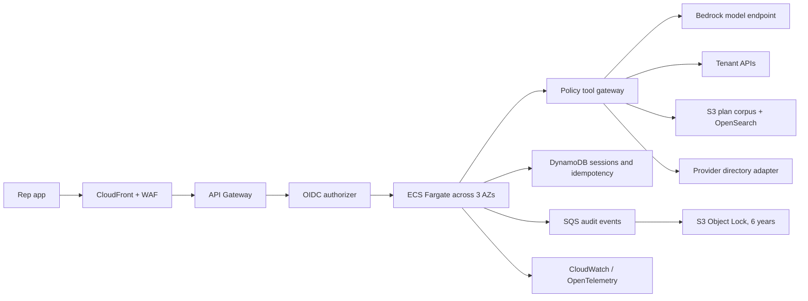

# Production Architecture (Assessment Design)

## Scope and flow

The service supports reps serving Harborview (`plan_a`) and Prairie Sky (`plan_b`). A rep asks benefit, claim, grievance, or provider questions for one active member. Reads use tenant APIs and tenant/product/year-aware plan documents. A grievance is drafted and read back, then created only after explicit rep confirmation. The local prototype uses deterministic rules for intent and tool selection. Optional local Ollama, Ollama Cloud, or an OpenAI-compatible model can only reword an answer after source facts are retrieved; it does not choose tools or authorize writes. In the production target, an approved model endpoint may support synthesis, but the deterministic gateway still owns authorization, minimization, budgets, and writes.

## AWS deployment

Deploy one region across availability zones. API Gateway/WAF fronts a stateless container service; ECS scales to 250 concurrent reps. OIDC claims map to tenant and role server-side. Tenant/member are bound to the session and injected into tool requests by the gateway; the model cannot choose or override them. The gateway uses typed allowlisted operations, validates each tenant/member, minimizes fields, redacts log content, enforces step/time/cost budgets, and emits a decision trace. Retrieval applies mandatory tenant, product, and effective-date filters before ranking. Provider search accepts only specialty, ZIP, and network; the vendor manifest is not an authority for policy.

DynamoDB stores encrypted short-lived session and confirmation state with conditional writes. The grievance draft is immutable once confirmed; persist an idempotency key before POST. On timeout or 503, reconcile using the same key/read-back and never issue an unbounded retry. Audit events are queued durably, then stored encrypted and immutable for six years. Operational telemetry uses correlation IDs and redacted tool names/latencies, not raw PHI. Secrets Manager and KMS protect credentials and keys; private subnets, least-privilege IAM, rate limits, backups, and tested recovery complete the baseline.

## NFR response

| Requirement | Design and limitation |
|---|---|
| 99.99% availability; one region | Multi-AZ compute/data, health checks, bounded retry/circuit breaking, graceful degradation. A single region retains regional outage risk; validate the SLO with managed-service commitments and failure tests. |
| p95 <3 s including claims | Minimize calls, use bounded parallel reads where safe, strict deadlines, and measure the full path. The supplied claims API adds 1.5 s per call and pagination, so the target is tight and cannot be promised without upstream performance/quota evidence. Never use stale claims to mask latency. |
| Isolation and PHI | Auth-derived tenant, mandatory filters/partitions, no cross-tenant cache keys, minimal model fields, no SSN/DOB to provider vendor, encryption, role-limited immutable audit. |
| Exactly-once confirmed write | Explicit two-phase confirmation, exact-draft binding, durable idempotency, reconciliation of ambiguous outcomes, auditable decision record. |
| ≤$0.03/conversation | Token/tool budgets, compact context, cache only non-PHI plan content, cost telemetry and load test. The default evaluation uses rules. Optional hosted providers have a per-conversation model-cost estimate cap; local Ollama has no token charge but uses compute. Total model plus infrastructure cost has not been measured and must be tested against the selected model and traffic. |
| 250 concurrent; portability | Autoscale stateless service, control downstream concurrency; portable container/API/schema and provider interfaces. Validate quotas and tenant-specific controls. |

## Prototype evidence and model-provider boundary

The current mock evaluation reports p95 of 2,536 ms across 40 cases, with no case above 3 seconds. This is a sample result, not a 250-rep load test. The default provider is `rules`; optional Ollama local, Ollama Cloud API-key, and hosted OpenAI-compatible modes rewrite only grounded answer text. No live model endpoint was used in the recorded evaluation. Cloud models receive member-linked answer text and require data approval; Ollama Cloud usage is token-priced even when starter credits are available.

## Azure mapping

| AWS | Azure |
|---|---|
| ECS Fargate / API Gateway / WAF | Container Apps or AKS / API Management / Front Door WAF |
| Cognito/OIDC and IAM | Entra ID / managed identities and RBAC |
| Bedrock | Azure AI Foundry endpoint behind a model adapter |
| S3 + OpenSearch | Blob Storage + Azure AI Search |
| DynamoDB / SQS | Cosmos DB or PostgreSQL / Service Bus |
| CloudWatch / KMS / Secrets Manager | Azure Monitor / Key Vault |
| S3 Object Lock | Immutable Blob Storage policy |

Keep portable the OCI container, OpenAPI contracts, schemas, policy rules, IaC intent, and OpenTelemetry conventions. Service semantics, quotas, model privacy, retention, and cost still require migration validation.

## Threat model

- **Cross-tenant IDOR/confused deputy:** derive tenant from authenticated claims; bind it to sessions; verify at gateway and data source; deny by default; test negative tenant/member combinations.
- **Prompt injection in user text, documents, notes, vendor responses:** treat content as data, never executable policy; use typed tool allowlists; keep authorization and confirmation outside the model.
- **PHI leakage to model/logs/vendor:** field allowlists and redaction, no raw prompts in telemetry, vendor adapter blocks SSN/DOB, access review and monitoring.
- **Unsafe manifest instruction:** reject its request to transmit SSN/DOB and conceal verification; implement a local approved schema and vendor review.
- **Duplicate/unauthorized grievance:** bind confirmation to immutable draft/member/tenant, persist idempotency before write, reconcile ambiguous outcomes, audit decisions.
- **Credential theft, abuse, or quota exhaustion:** managed secrets, scoped identities, rotation, per-rep/tenant throttles, bounded retries, circuit breaker, anomaly alerts.
- **Audit tampering / retention exposure:** encrypted append-only archive, separate audit role, retention lock, minimized payload, access logs.

## Architecture decisions

1. **Shared service with hard tenant controls.** A shared multi-AZ application satisfies year-one cost goals; identity, data, retrieval, cache, and logs are tenant-scoped. Separate stacks cost more; prompt-only isolation is rejected. Shared operation requires negative isolation testing.
2. **Deterministic gateway outside model.** All calls pass through typed policy checks for identity, PHI, budgets, and audit. Direct model-to-API access is rejected. This adds gateway code but makes controls testable.
3. **Two-phase grievance with idempotency.** Rep confirmation binds to a fixed draft, followed by one idempotent write and reconciliation. Inferred consent and blind retry are rejected. This adds a turn and durable state requirement.
4. **Versioned, metadata-filtered retrieval.** Filter by tenant/product/effective date before ranking. A global unfiltered index and hard-coded benefits risk wrong-plan answers. Metadata ingest/validation is required.
5. **Single-region multi-AZ, portable contracts.** Avoid year-one multi-region cost while isolating cloud services behind interfaces. Regional outage remains an accepted risk; Azure migration needs service-level validation.
